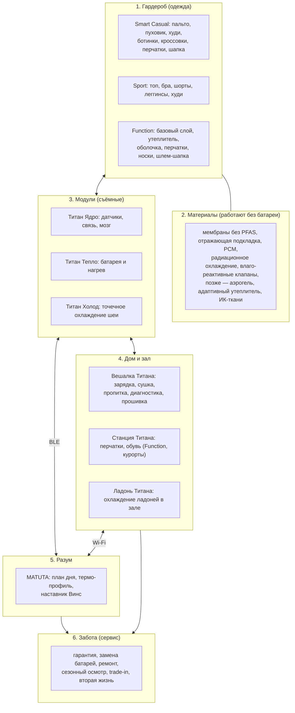

# Северная звезда: экосистема «Титан» через 5–7 лет

> **Версия:** v0.1 · **Статус:** черновик на обсуждение с основателем · **Дата:** 2026-11-25
> **Владелец:** Стратегия, совместно с «Технологиями», «Наукой и медициной» и «Дизайном»
> **Основание:** сообщения основателя 25.11.2026 (охлаждение по зонам, вентиляция, пьезо, умная вешалка, «это всё-таки одежда», самые технологичные материалы)
> **Связано:** [vision-mission.md](vision-mission.md), [path-to-north-star.md](path-to-north-star.md), [../04-tech/06-advanced-materials.md](../04-tech/06-advanced-materials.md), [../04-tech/07-cooling-and-ventilation.md](../04-tech/07-cooling-and-ventilation.md), [../04-tech/08-smart-hanger.md](../04-tech/08-smart-hanger.md)
> **Источники:** [north-star-sources.md](north-star-sources.md) **[N№]**, [../04-tech/99-sources.md](../04-tech/99-sources.md) **[S№]**. Гипотезы помечены.

## Резюме

- **Северная звезда:** **«Личный климат Титана».** К 2032 году Титан не думает о температуре своего тела ни в городе, ни в зале, ни в горах. Одежда, материалы, модуль, вешалка и MATUTA вместе держат тело в рабочем диапазоне сами.
- **Это одежда, а не гаджет.** Большую часть работы делают материалы без батареи. Электроника включается там, где материал не справился, и с каждым поколением включается реже.
- **Главная метрика — «Часы в комфорте»:** доля времени носки, когда тело в комфортной зоне без ручного вмешательства. Цель 2032 года — ≥ 90 % **[Гипотеза]**.
- **Бизнес-модель:** премиальная одежда и модули + «Вешалка Титана» + сервис «Титан Забота». Обязательной подписки на функции нет. Аналитика — в общей подписке «Здоровья Титана».

---

## 1. Северная звезда одной фразой

> **Одежда, которая держит твой личный климат сама: тёплая на морозе, сухая в метро, прохладная в зале, и каждое утро готова к твоему дню.**

Почему это сильнее, чем «умная одежда с подогревом»:
- подогрев уже продают все, от ORORO до Ralph Lauren (см. [../01-research/competitors.md](../01-research/competitors.md));
- сенсорная одежда показывает цифры, но рынок их не купил (OMsignal, Athos, Jacquard — там же);
- **никто не продаёт результат: «тебе всегда комфортно»**. Мы продаём результат, а технологии — способ его добиться.

## 2. Метрики Северной звезды

| Метрика | Что меряем | Цель 2032 | Почему |
|---|---|---|---|
| **Часы в комфорте** (главная) | доля времени носки, когда температура кожи и влажность микроклимата в целевом диапазоне ([03-science 02 §3.3](../03-science/02-thermoregulation-comfort.md)) и человек не вмешивался вручную; плюс один вопрос в неделю «было ли тебе комфортно?» | ≥ 90 % **[Гипотеза]** | меряет обещание бренда, а не число датчиков |
| **Ватт-часы на час комфорта** | сколько энергии батарей тратится на час комфорта | снижать на 20–30 % с каждым поколением **[Гипотеза]** | меряет, насколько работу взяли на себя материалы |
| **Изделий на человека** | сколько вещей «Титан» носит один клиент | ≥ 3 **[Гипотеза]** | гардероб, а не одна куртка |
| **Срок жизни изделия** | лет носки до ремонта, перепродажи или переработки | ≥ 5 лет **[Гипотеза]** | премиум и ESG; модули меняются, одежда остаётся |

## 3. Из чего состоит экосистема в 2032 году

| Слой | Роль | Что нового по сравнению с рынком |
|---|---|---|
| **1. Гардероб** | красивая премиальная одежда, которую хочется носить и без электроники | три линейки на одной платформе; мужская и женская посадка с первого дня |
| **2. Материалы** | делают основную работу по комфорту без энергии | правило «материал сначала» ([04-tech 06](../04-tech/06-advanced-materials.md)) |
| **3. Модули** | одно Ядро на все вещи; Тепло и Холод — по задаче | электроника переходит из вещи в вещь, одежда стирается |
| **4. Дом и зал** | заряжает, ухаживает, проверяет, готовит к утру | вешалка, которая знает, что ты наденешь завтра ([04-tech 08](../04-tech/08-smart-hanger.md)) |
| **5. Разум (MATUTA)** | знает тело, план и погоду; учит личный термо-профиль | одежда действует заранее, а не по кнопке |
| **6. Забота** | продлевает жизнь вещи | доход от сервиса вместо подписки на функции |

### 3.1 Как охлаждаем и греем: принцип в одну строку на линейку

| Линейка | Тепло | Прохлада |
|---|---|---|
| **Smart Casual** | материал + подогрев торса и кистей по коже и плану дня | снять подогрев и открыть вентиляцию на переходе в тепло; холод не нужен |
| **Sport** | — | вентиляция и испарение в ткани; «Титан Холод» на шею для ощущения; «Ладонь Титана» между раундами для реального снижения температуры тела |
| **Function** | многозонный подогрев, режим «подъёмник», аварийный режим | вентиляция под оболочкой на подъёме (молнии, микро- или пьезовентиляторы), радиационное охлаждение на весеннем солнце |

Основание: точечное охлаждение меняет **ощущение** за ≈1 Вт [N14][N16], но не меняет температуру ядра [N4]. Ядро снижают испарение с обдувом [N5][N6] и холод на ладонях [N1]. Пельтье на всё тело от батареи не работает [S9]. Подробно — [04-tech 07](../04-tech/07-cooling-and-ventilation.md).

## 4. Один день Титана в 2032 году [сценарий-гипотеза]

**06:40.** MATUTA видит короткий сон и лёгкую тренировку вечером. На улице −14 °C и ветер. Ночью «Вешалка Титана» высушила пуховик (утром он на 38 г легче, чем вчера вечером), восстановила пропитку и дозарядила батарею с 60 до 100 % к выходу.

**07:55.** За 7 минут до выхода по календарю вешалка прогревает пуховик от сети. Титан надевает тёплую вещь, а батарея ещё полная.

**08:05.** Улица. Аэрогелевый утеплитель и отражающая подкладка держат тепло сами. Подогрев торса включается на 20 % только на остановке, когда кожа кистей опускается ниже порога.

**08:20.** Метро, +24 °C, людно. Влажность под курткой растёт. Подогрев выключился за секунды, клапаны на спине открылись от влаги сами, без мотора.

**12:30.** Обед. MATUTA пишет: «Сегодня ты был в комфорте 96 % времени на улице».

**19:00.** Зал, кроссфит. Sport-топ светится цветом пульсовой зоны, тренер видит всех атлетов. Между раундами — 3 минуты ладони на «Ладони Титана». Температура тела по модели снижается, мощность в последнем раунде держится.

**20:15.** MATUTA: «Потеря влаги ≈1,1 л. Выпей 1,5 л до сна». Топ — в стиральную машину, Ядро — на вешалку.

**Суббота, 09:00, склон.** Function-комплект. На подъёме в гору вентиляция под оболочкой открыта, на подъёмнике — закрыта и включён подогрев. Перчатки предупреждают о риске обморожения пальцев. Вечером в отеле «Станция Титана» сушит перчатки и ботинки.

**Раз в месяц.** Вешалка сообщает: «Сопротивление зоны 3 в перчатке выросло на 9 %. Замена в рамках «Титан Заботы» назначена». Человек ничего не чинит сам.

## 5. Позиционирование

**Категория:** «одежда личного климата» (personal climate apparel) **[Гипотеза: название для теста в 08-gtm]**.

| | Пассивная | Действует сама |
|---|---|---|
| **Премиальная одежда** | премиальные пуховики и outdoor-бренды | **«Титан»** |
| **Утилитарная или гаджет** | обычная одежда | одежда с подогревом по кнопке; сенсорные футболки |

**Обещание:** «Тебе всегда комфортно. Ты не думаешь об этом».
**Почему поверят:** наука о терморегуляции в основе (03-science), открытые цифры испытаний, связь с MATUTA, сервис, который чинит за тебя.
**Чем трудно скопировать:** личный термо-профиль, обученный на данных тела и дня; система из одежды, модулей, вешалки и приложения; сервисная сеть. Нагреватель купит любой бренд, систему — нет (см. [value-proposition.md](value-proposition.md)).

## 6. Бизнес-модель Северной звезды [Гипотеза, считает 07-finance]

| Поток | Что продаём | Доля выручки в 2032 | Логика |
|---|---|---|---|
| **Одежда** | изделия трёх линеек, маржа премиальной одежды | ≈55 % | одежда — главный продукт |
| **Модули** | Ядро, Тепло, Холод; апгрейд раз в 2–3 года | ≈15 % | одна покупка на весь гардероб, обновление по желанию |
| **Дом и зал** | Вешалка, Станция, Ладонь (B2C и B2B) | ≈15 % | ежедневная точка контакта и уход |
| **«Титан Забота»** | гарантия, батареи, ремонт, сезонный осмотр, trade-in | ≈10 % | повторная выручка за реальную работу, а не за доступ к функции |
| **Данные и аналитика** | в общей подписке «Здоровья Титана», без отдельной подписки одежды | ≈5 % (доля одежды в подписке HoT) | урок рынка: «ещё одна подписка» убивает сенсорную одежду ([01-research](../01-research/competitors.md)) |

Принципы: базовые функции (тепло, вентиляция, цвет зоны, безопасность) работают без подписки и без интернета, как уже решено в [vision-mission.md §4](vision-mission.md).

## 7. Чего мы не делаем

1. Не делаем гаджет, который надо носить ради технологии. Сначала одежда.
2. Не обещаем охлаждения всего тела от батареи и не используем Пельтье на торсе.
3. Не используем озон и УФ-С для ухода за тканью.
4. Не ставим диагнозов: wellness, а не медицина (см. [03-science 06](../03-science/06-medical-device-boundary.md)).
5. Не вводим обязательную подписку на функции одежды.
6. Не синтезируем материалы сами: партнёрства с лабораториями и фабриками.

## 8. Решения для основателя

1. Принять «Личный климат Титана» как Северную звезду и «Часы в комфорте» как главную метрику?
2. Принять «Вешалку Титана» как обязательную часть экосистемы со второго шага (см. [path-to-north-star.md](path-to-north-star.md)), а не как поздний аксессуар?
3. Охлаждение в Sport делать через вентиляцию в одежде и станцию для ладоней (B2B для залов), а точечный модуль на шею — через партнёра на старте?
