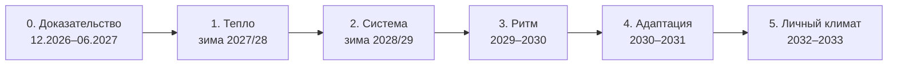

# Путь к Северной звезде: этапы, вехи, условия перехода

> **Версия:** v0.1 · **Статус:** черновик; сроки — **[Гипотеза]**, порядок линеек уточняется по данным о спросе · **Дата:** 2026-11-25
> **Владелец:** Стратегия · **Связано:** [north-star.md](north-star.md), [../02-product/launch-line-recommendation.md](../02-product/launch-line-recommendation.md), [../01-research/demand-signals.md](../01-research/demand-signals.md), [../04-tech/04-trl.md](../04-tech/04-trl.md)
> **Источники:** [north-star-sources.md](north-star-sources.md) **[N№]**, [../04-tech/99-sources.md](../04-tech/99-sources.md) **[S№]**.

## Резюме

- **Шесть этапов** от проверки спроса до «Личного климата Титана». Каждый этап добавляет **один новый слой** экосистемы и переходит к следующему только при выполнении условий.
- Этапы названы по тому, что человек получает: **Доказательство → Тепло → Система → Ритм → Адаптация → Личный климат**.
- **Вешалка появляется на этапе 2**, а не в конце: без неё модульная электроника — лишняя забота для человека.
- Порядок Sport и Function может поменяться местами по результатам тестов спроса T1–T6 (см. [launch-line-recommendation.md §4](../02-product/launch-line-recommendation.md)).

---

## 1. Карта пути

| Этап | Что получает Титан | Новые продукты | Новый слой экосистемы |
|---|---|---|---|
| **0. Доказательство** | — (исследования и предзаказ) | прототипы, видео-демо | — |
| **1. Тепло** | тёплый торс и руки на автоматике | SC-1 жилет, SC-5 перчатки, «Титан Ядро Lite», «Титан Тепло», простой док | Гардероб v1 + Модули + MATUTA |
| **2. Система** | одежда сама готова каждое утро | FN-1 перчатки, FN-2 носки, SC-2 пуховик, «Вешалка Титана» v1, «Станция Титана» для курортов | Дом + Забота v1 |
| **3. Ритм** | зал, где одежда показывает усилие и помогает остыть | SP-1 топ, SP-2 бра со светом зоны; «Ладонь Титана» для залов; «Титан Холод» (партнёр) | Зал |
| **4. Адаптация** | одежда, которая чаще справляется без батареи | материалы v2: радиационное охлаждение, влаго-реактивные клапаны, биоволокна; электрохромная вставка Sport; пальто и обувь SC | Материалы v2 |
| **5. Личный климат** | «я не думаю о температуре тела» | аэрогель и адаптивный утеплитель, ИК-ткани, термо-двойник в MATUTA, интеграция с паровыми шкафами | Материалы v3 + полный Разум |

## 2. Этапы подробно

### Этап 0. Доказательство (декабрь 2026 — июнь 2027)
**Цель:** решить, с чего стартовать, на данных, а не на мнении.
- Тесты спроса T1–T6 ([demand-signals.md §4](../01-research/demand-signals.md)), включая новый вопрос о вешалке: «заплатите ли $249–349 за вешалку, которая сушит, заряжает и готовит одежду к утру» **[Гипотеза: добавить как T7]**.
- Климатическая камера: пороги автоматики подогрева, сравнение способов охлаждения ([04-tech 07 §5](../04-tech/07-cooling-and-ventilation.md)).
- Прототипы: Ядро Lite + Тепло в жилете; макет вешалки с сушкой и зарядкой.
- Партнёры по материалам v1: мембраны без PFAS, отражающая подкладка, PCM.

**Условия перехода на этап 1:**
1. Тест T5 подтвердил премию за автоматику и дизайн в городе (порог — в [launch-line-recommendation.md §4](../02-product/launch-line-recommendation.md)); если нет — стартуем с Function.
2. Прототип в камере держит целевую температуру кожи при −15 °C с меньшей средней мощностью, чем ручной подогрев **[Гипотеза: цель −20 % энергии]**.
3. Нет блокирующих патентов на автоматическое управление подогревом (06-ops-legal).
4. Найден производитель одежды с подогревом и поставщик модулей (05-suppliers).

### Этап 1. Тепло (запуск к зиме 2027/28)
**Цель:** доказать платформу «Ядро + гардероб» и бренд на самом понятном спросе — тепле.
- Продукты: SC-1 жилет, SC-5 перчатки. Материалы v1. Простой док для зарядки модулей.
- MATUTA: модуль `:integration:garment`, функция «Тепло» с прогревом к выходу ([04-tech 02 §5](../04-tech/02-reference-architecture.md)).
- Измеряем «Часы в комфорте» с первого дня.

**Вехи:** предзаказ, малая серия, отзывы первых 500–1 000 клиентов **[Гипотеза]**.
**Условия перехода на этап 2:**
1. Возвраты ниже 8 % и средняя оценка ≥ 4,5 из 5 **[Гипотеза: пороги утверждает 07-finance]**.
2. «Часы в комфорте» у активных пользователей ≥ 75 % **[Гипотеза]**.
3. Доля клиентов, которые забыли зарядить модуль хотя бы раз в месяц — меряем; если высокая, это подтверждает нужность вешалки.
4. Отказов нагревателей и батарей меньше 2 % за сезон **[Гипотеза]**.

### Этап 2. Система (зима 2028/29)
**Цель:** превратить вещи в систему, которая сама готова каждое утро.
- Продукты: FN-1 и FN-2 на том же Ядре; флагман SC-2 пуховик с вентиляционными зонами; **«Вешалка Титана» v1** (зарядка, сушка, взвешивание, пропитка, диагностика, прошивка; без пара, озона и УФ-С — [04-tech 08](../04-tech/08-smart-hanger.md)).
- «Станция Титана» — пилот на 1–3 горнолыжных курортах.
- Запуск «Титан Заботы» v1: гарантия, замена батарей, сезонный осмотр.

**Условия перехода на этап 3:**
1. ≥ 30 % владельцев изделий купили или получили вешалку **[Гипотеза]**.
2. Второе изделие покупает ≥ 25 % клиентов этапа 1 **[Гипотеза]**.
3. Пилот Sport (видео-прототип цвета, клубы HYROX, тест T3) дал сильный сигнал; если сигнал сильный раньше — этап 3 идёт параллельно этапу 2.

### Этап 3. Ритм (2029–2030)
**Цель:** круглогодичная линейка и самые глубокие данные для MATUTA.
- Продукты: SP-1 топ и SP-2 бра (ЭКГ-пульс, свет пульсовой зоны, потеря влаги, температура кожи); ЭМГ как бета.
- Охлаждение в Sport ([04-tech 07 §3](../04-tech/07-cooling-and-ventilation.md)): вентиляция и испарение в ткани; **«Ладонь Титана»** — станция охлаждения ладоней для залов (B2B) и дома; **«Титан Холод»** на шею — через партнёра или ODM.
- Индекс тепловой нагрузки по пульсу в MATUTA как условие безопасности точечного охлаждения.

**Условия перехода на этап 4:**
1. Точность ЭКГ-пульса в кроссфит-протоколе на уровне нагрудного ремня **[Гипотеза: порог задаёт 03-science]**.
2. ≥ 20 залов-партнёров со станциями **[Гипотеза]**.
3. Выручка вне зимнего сезона ≥ 30 % годовой **[Гипотеза]**.

### Этап 4. Адаптация (2030–2031)
**Цель:** перенести работу с батареи на материалы.
- Материалы v2 ([04-tech 06 §4](../04-tech/06-advanced-materials.md)): радиационно-охлаждающие панели, влаго-реактивные клапаны, биоволокна в верхнем слое; электрохромная вставка Sport после 50 стирок.
- Гардероб Smart Casual: пальто, ботинки и кроссовки с подогревом стопы.
- Вешалка v2: интеграция с LG ThinQ и Samsung SmartThings или собственный шкаф — по данным этапа 2.

**Условия перехода на этап 5:**
1. «Ватт-часы на час комфорта» снизились на ≥ 20 % к этапу 1 при тех же «Часах в комфорте» **[Гипотеза]**.
2. Материалы v3 (аэрогель, адаптивный утеплитель, ИК-ткани) прошли у партнёров испытания на стирку и прочность и есть путь к серийному объёму.

### Этап 5. Личный климат (2032–2033)
**Цель:** Северная звезда ([north-star.md](north-star.md)).
- Аэрогелевый утеплитель: пальто, тёплое как пуховик, при толщине в 3–5 раз меньше [N25].
- Адаптивный по толщине утеплитель на LCE-волокнах [N32] и ткани с регулируемой ИК-проницаемостью [N28].
- Термо-двойник в MATUTA: личная модель тела, которая заранее выбирает режим каждой вещи.
- «Часы в комфорте» ≥ 90 %.

## 3. Что делаем уже сейчас, на этапе 0

| Отдел | Задача |
|---|---|
| Наука и медицина | протокол камеры: охлаждение шеи, запястья, ладоней, обдув; пороги сушки для пуха и мембран |
| Технологии | прототип вешалки (сушка + док + взвешивание); испытания пьезонасосов воздуха; список лабораторий материалов |
| Дизайн | вешалка и чехол как предмет интерьера; карта вентиляционных зон |
| Операции и право | запрет PFAS по рынкам, требования к бытовым приборам и ионизаторам, патенты на вешалки с зарядкой |
| Финансы и инвестиции | модель «одежда + модули + вешалка + Забота»; доля выручки по потокам |
| Адвокат дьявола | атаковать: нужна ли вешалка, если модуль можно зарядить от USB-C; не превращается ли «Титан» в бытовую технику |

## 4. Главные риски пути

1. **Сложность системы раньше спроса.** Ответ: каждый слой появляется только после выполнения условий предыдущего этапа.
2. **Материалы v3 не выйдут из лаборатории вовремя.** Ответ: Северная звезда достижима и на материалах v2; v3 улучшает метрику энергии, но не блокирует обещание.
3. **Вешалка — это бытовая техника с другой логистикой и сертификацией.** Ответ: v1 простая (без пара и воды), v2 — через партнёров.
4. **Точечное охлаждение маскирует перегрев.** Ответ: работает только вместе с индексом тепловой нагрузки ([04-tech 07](../04-tech/07-cooling-and-ventilation.md)).
