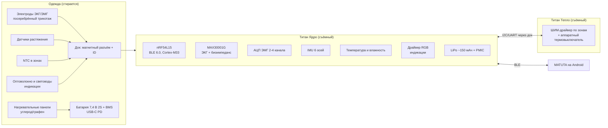
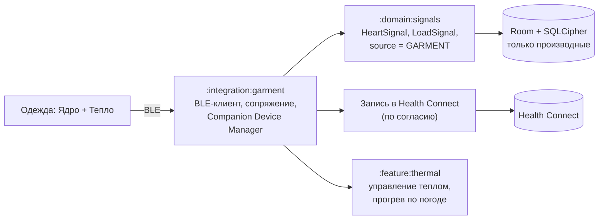

# 04-tech · 02. Референсная архитектура: модуль, BLE, прошивка, интеграция с MATUTA

Версия 0.1 · 2026-11-25 · Источники — [99-sources.md](99-sources.md).

## 1. Принципы

1. **Одно ядро на все линейки.** Модуль «Титан Ядро» одинаков для Smart Casual, Sport и Function; вещь сообщает модулю, кто она (ID-резистор или NFC-метка в доке), и модуль включает нужный профиль.
2. **Безопасность и цвет работают без телефона.** Пульсовая зона и управление нагревом считаются на самом модуле. Телефон задаёт настройки и получает данные.
3. **Как в MATUTA: local-first и минимум данных.** Сырые сигналы (ЭКГ, ЭМГ) живут в памяти модуля и телефона и не сохраняются; хранятся только производные показатели. Это повторяет правило MATUTA ADR-02 и §11.8 [S36]. Сервер Cloudflare Worker данные о здоровье не хранит [S36].
4. **Одежда — равный источник.** В MATUTA одежда подключается так же, как WHOOP и Health Connect: через интерфейсы сигналов с полями `source` и `confidence` [S36].
5. **Открытые стандарты там, где они есть.** Пульс отдаётся по стандартному Bluetooth Heart Rate Service, поэтому одежда работает с часами и любыми спортивными приложениями.

## 2. Аппаратная схема

| Узел | Референсный выбор | Почему | Альтернатива |
|---|---|---|---|
| SoC и радио | Nordic nRF54L15, модуль Ezurio BL54L15 [S12][S32] | BLE-соединение 26 мкА, 20 мкА/МГц, 22 нм [S12]; готовый сертифицированный модуль ускоряет радиосертификацию [S32] | nRF52840 (проверен в текстильной ЭКГ [S1]) |
| ЭКГ, дыхание | ADI MAX30001G [S13] | один чип: ЭКГ и биоимпеданс (дыхание) | TI ADS1293 [S1] |
| ЭМГ | многоканальный биопотенциальный АЦП, 2–4 канала **[Гипотеза: выбор чипа после прототипа]** | сигнал единицы мВ [S3] | — |
| Температура кожи | цифровой датчик ±0,1 °C (класс TI TMP117) **[Гипотеза: по даташиту]** | управление нагревом | NTC |
| Влажность | класс Sensirion SHT4x **[Гипотеза]** | оценка потери влаги | — |
| Индикация | RGB-светодиоды в доке + световоды и POF в ткани [S38] | см. 01 §3 | электрохромная вставка в v2 [S6] |
| Нагрев | 2S Li-ion, MOSFET ШИМ по 3–8 зонам, NTC на каждую зону | стандарт рынка 7,4 В [S31] | USB-PD 5–12 В от павербанка, как у Graphene-X [S10] |

## 3. Протокол BLE (GATT)

| Сервис | UUID | Назначение |
|---|---|---|
| Heart Rate Service | 0x180D (стандарт SIG) | ЧСС и RR-интервалы, совместимость с часами и приложениями |
| Battery Service | 0x180F (стандарт SIG) | заряд Ядра; для Тепла — во втором экземпляре сервиса |
| Device Information | 0x180A (стандарт SIG) | производитель, модель, версии ПО, тип вещи |
| Environmental Sensing | 0x181A (стандарт SIG) | температура и влажность микроклимата |
| **Titan Body** | собственный 128-бит | дыхание, индекс нагрузки мышц (ЭМГ), оценка потери влаги, текущая пульсовая зона, события (начало и конец тренировки, «снят с тела») |
| **Titan Thermal** | собственный 128-бит | целевая температура по зонам, режимы (эко, комфорт, буст, прогрев к времени), телеметрия мощности, ошибки безопасности |
| **Titan Config** | собственный 128-бит | границы пульсовых зон и цвета, профиль вещи, калибровки |
| **Titan Stream** (только по запросу) | собственный 128-бит | сырые ЭКГ и ЭМГ для валидации и исследований; выключен по умолчанию |
| DFU | SMP (MCUmgr) | обновление прошивки по воздуху |

- **Безопасность связи:** LE Secure Connections, сопряжение и привязка, шифрование канала; в рекламном пакете нет данных о здоровье и постоянного идентификатора **[Гипотеза: детали — в спецификации прошивки]**.
- **Пропускная способность [Расчёт]:** ЭКГ 256 Гц × 3 байта ≈ 0,8 КБ/с, ЭМГ 4 канала × 1 кГц × 2 байта ≈ 8 КБ/с. Это укладывается в BLE 2M PHY с запасом. В обычном режиме по воздуху идут только производные показатели, раз в секунду.

## 4. Прошивка

- **ОС:** Zephyr RTOS в составе nRF Connect SDK; загрузчик MCUboot с проверкой подписи образа; обновление по воздуху через телефон.
- **Задачи на модуле:**
  1. Детектор R-зубцов (класс Pan–Tompkins) → ЧСС 1 Гц, RR-интервалы, оценка качества сигнала.
  2. Пульсовые зоны: границы задаёт MATUTA (Config), модуль сам переключает цвет. Гистерезис 3 уд/мин и 5 с удержания, чтобы цвет не «мигал» на границе **[Гипотеза: параметры уточнит отдел «Наука»]**.
  3. ЭМГ: огибающая RMS → индекс нагрузки 0–100 по каждой группе мышц относительно личного максимума из калибровки.
  4. Дыхание по биоимпедансу или датчику растяжения.
  5. Детектор «на теле или нет» по контакту электродов и температуре. Когда вещь снята, данные не пишутся, как требует Health Connect [S14].
  6. **Управление нагревом:** ПИ-регулятор по датчику кожи с ограничением мощности. Аппаратный термовыключатель и сторожевой таймер в модуле Тепло работают независимо от Ядра.
  7. Буфер на модуле: 24 ч производных показателей на случай, если телефона нет рядом **[Гипотеза: объём флеш-памяти]**.

## 5. Интеграция с MATUTA

### 5.1 Как устроено приложение сейчас (по репозиторию health-of-a-titan, только чтение)
- Нативный Android: Kotlin, Compose, Hilt, Room + SQLCipher, WorkManager; `minSdk 34` [S36].
- Health Connect подключён модулем `:integration:healthconnect` (пока только шаги телефона) [S36].
- WHOOP, Health Connect и ручной ввод — равные источники; домен работает через интерфейсы `NightSignal`, `LoadSignal`, `StepsSignal`, `HeartSignal` с `source` и `confidence` [S36].
- Сырые данные внешних источников не хранятся, хранятся только производные показатели HoT [S36].

### 5.2 Что добавить

- **Новый модуль `:integration:garment`:** BLE-клиент, сопряжение через Companion Device Manager, фоновый сбор данных во время тренировки (foreground service типа `connectedDevice` и `health`) **[Гипотеза: типы службы проверить под targetSdk 36]**.
- **Сигналы:** одежда становится источником `GARMENT` в `HeartSignal` (ЧСС, ВСР, зоны) и `LoadSignal` (TRIMP по зонам, индекс мышц). При ЭКГ на груди `confidence` выше, чем у оптики на запястье, — это решает модель сигналов MATUTA.
- **Новая фича «Тепло»:** пресеты, прогрев к выходу по календарю и прогнозу погоды, история расхода батареи.
- **Согласия:** отдельное согласие на одежду как источник и отдельное — на запись в Health Connect, в духе единого согласия MATUTA (A68) [S36].

### 5.3 Соответствие типам Health Connect

| Показатель одежды | Тип записи Health Connect | Пишем? |
|---|---|---|
| ЧСС | `HeartRateRecord` | да |
| ВСР (RMSSD) в покое | `HeartRateVariabilityRmssdRecord` | да |
| Частота дыхания | `RespiratoryRateRecord` | да |
| Тренировка | `ExerciseSessionRecord` | да, если MATUTA начала тренировку |
| Температура кожи (грудь, спина) | `SkinTemperatureRecord` | **нет:** тип поддерживает места finger, toe, wrist и не предназначен для температуры ядра [S15]; храним только в MATUTA |
| Потеря влаги с потом | нет подходящего типа (`HydrationRecord` — это выпитое) **[Гипотеза: проверить актуальный список типов]** | нет, только MATUTA |
| Индекс нагрузки мышц (ЭМГ) | нет типа | нет, только MATUTA |

- **Метаданные каждой записи:** `Device.type`, `manufacturer`, `model`, `recordingMethod = AUTOMATICALLY_RECORDED` обязательны с версии 1.1.0-rc01 [S14]. Для футболки Sport — тип «нагрудный датчик» (`TYPE_CHEST_STRAP`) **[Гипотеза: сверить с актуальным списком констант Device]**.
- **Правила записи:** не писать нули и данные, когда вещь снята; пакеты до 1000 записей; писать только новое с прошлой синхронизации [S14].

## 6. Открытые вопросы
1. Будет ли iOS (Apple HealthKit) в первой волне? MATUTA сейчас только Android [S36].
2. Нужен ли «Titan Stream» в серийном ПО или только в исследовательских сборках.
3. Выбор разъёма: магнитный пружинный или кнопочный — после ресурсных испытаний.
