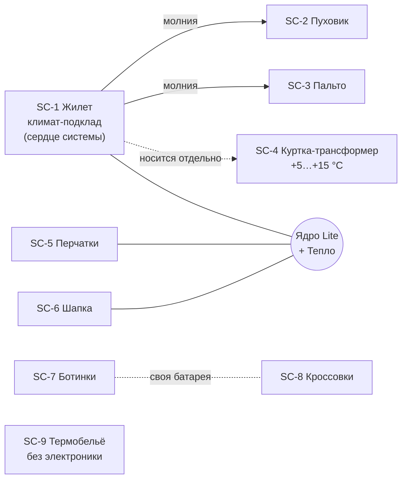

# 03. Smart Casual: ассортимент и конструкция изделий

> **Версия:** v0.1 · **Дата:** 2026-11-28 · **Статус:** черновик; конструкция — **[Гипотеза]** до макетов и климатической камеры
> **Отдел:** Дизайн · **Источники:** [99-sources.md](99-sources.md) · **Платформа:** [02-platform-construction.md](02-platform-construction.md) · **Карта зон:** [assets/zones-smart-casual.svg](assets/zones-smart-casual.svg)
> **Ассортимент и цены** — от Стратегии ([../02-product/lines-and-assortment.md §1](../02-product/lines-and-assortment.md)); здесь — как изделия устроены и выглядят.

## Резюме

- **Линейка — «город от −25 до +15 °C».** Задача дизайна — премиальная городская одежда, где подогрев включается сам, а на переходе в метро вещь сама остывает и открывает вентиляцию [Sci: Parkinson2015].
- **Система, а не набор:** жилет SC-1 — это климат-подклад, который пристёгивается в пуховик SC-2 и пальто SC-3. Первая покупка становится сердцем следующих **[Решение дизайна]**.
- **Первая волна (по Стратегии):** SC-1 жилет и SC-5 перчатки [../02-product/launch-line-recommendation.md §3]. Под них дизайн готов первым.
- **Биометрию из верхней одежды не обещаем:** между кожей и курткой 1–3 слоя одежды, поэтому меряем микроклимат, а не тело [../03-science/01-sensing-from-textile.md §1].

---

## 1. Карта линейки

## 2. Изделия

### SC-1 · Жилет «Климат» — герой 1, первая волна

| Параметр | Решение |
|---|---|
| Роль | средний слой под пальто или пиджак; самостоятельный жилет в межсезонье; климат-подклад для SC-2 и SC-3 ([02 §4](02-platform-construction.md)) |
| Силуэт | прямой, длина до середины бедра у мужской модели и чуть ниже талии у женской; воротник-стойка 4 см; плоские стёжки без «пухлых» секций, чтобы жилет помещался под пальто **[Гипотеза]** |
| Материалы | верх — матовый тонкий полиамид с мембраной от ветра; утеплитель синтетический 60–80 г/м² **[Гипотеза]**; подкладка — отражающая ≤ 60 % [N29] + PCM на груди и спине [N33] + печать «Изотерма» |
| Нагрев | H1 спина, H2 поясница, H3/H4 грудь ([02 §2.1](02-platform-construction.md)); предел 42 °C на коже |
| Порт | внутренний карман слева на талии; Связка «Ядро Lite + Тепло Casual» (≈20 Вт·ч) |
| Корона | левая полочка на уровне груди, под планкой молнии |
| Пристёгивание | молния по переду и кнопки на проймах; совместим с SC-2 и SC-3 в своём размере |
| Вентиляция | не нужна: жилет без рукавов, а сброс тепла — автоматикой |
| Уход | Связку вынуть, стирать 30 °C деликатно; 30 циклов [../04-tech/01 §5] |
| Масса, цель | ≤ 450 г без Связки **[Гипотеза]** |
| Колорвеи | графит, чёрный, песок |

### SC-2 · Пуховик-парка — герой 2, флагман

| Параметр | Решение |
|---|---|
| Силуэт | прямая парка до середины бедра; капюшон со съёмной опушкой из искусственного меха; «монолит» — без внешних карманов-накладок, скрытая двусторонняя молния под ветрозащитной планкой |
| Материалы | верх — 2-слойная мембрана без PFAS [N30]; пух 700+ fill или синтетика (вариант для веганской линии) **[Гипотеза]**; отражающая подкладка с «Изотермой» |
| Нагрев | собственные зоны: H5/H6 карманы для кистей, H7 воротник; торс — через пристёгнутый SC-1 (вариант А) **или** встроенный подклад H1–H4 (вариант Б, как у Стратегии «3–5 зон»). Рекомендация дизайна — вариант А |
| Порт | внутренний карман слева на талии; если пристёгнут SC-1, работает Порт жилета, а карманы и воротник подключаются к нему разъёмом в кармане |
| Вентиляция | V1 скрытый клапан на кокетке спины с магнитной фиксацией; V5 вертикальные молнии на груди, работают как карманы и как вентиляция |
| Корона | левая полочка, под ветрозащитной планкой; доступна, когда парка застёгнута |
| Индикация | световая линия вокруг Короны; снаружи не светится ничего, кроме неё **[Решение дизайна]** |
| Уход | внешний слой без электроники — стирка пуха или химчистка; подклад — отдельно |
| Колорвеи | чёрный, графит, песок, глубокий тёмно-синий |

**Решение для основателя (вариант А или Б):**

| | А. Пуховик + жилет-подклад | Б. Пуховик со встроенным нагревом |
|---|---|---|
| Покупателю | две вещи и одна электроника; жилет носится отдельно | одна вещь, всё внутри |
| Цена входа | ниже для тех, у кого уже есть SC-1 | выше, но понятнее |
| Себестоимость электроники | раз на систему | в каждой куртке ([../04-tech/03 §3]: 12–20 $ электроники в пуховике) |
| Тепло без модуля | пуховик держит холод сам | так же |
| Риск | лишние 3–5 мм и 150–250 г **[Гипотеза]**; надо не забыть пристегнуть | дороже ремонт и стирка |

### SC-3 · Пальто

| Параметр | Решение |
|---|---|
| Силуэт | классическое однобортное пальто до колена, «Классика снаружи. Твой климат внутри» — слоган кампании [D11] |
| Материалы | шерсть или шерсть с биоволокном (v2, Spiber [N31]) на мембране; утеплитель — тонкая синтетика, в v3 — аэрогелевое волокно [N25] |
| Нагрев | H5/H6 карманы (через стенку кармана, обращённую к телу); торс — пристёгнутый SC-1 (единственный вариант: в пальто встроенная электроника нарушила бы драпировку) **[Решение дизайна]** |
| Порт | внутренний карман слева на талии в подкладке пальто |
| Корона | под лацканом слева: не видна снаружи |
| Вентиляция | шлица сзади; клапан V1 не нужен **[Гипотеза: пальто дышит больше пуховика]** |
| Уход | химчистка шерсти без подклада и Связки; пар на «Вешалке» v2 только для шерсти [../04-tech/08 §3] |

### SC-4 · Лёгкая куртка-трансформер (+5…+15 °C)

| Параметр | Решение |
|---|---|
| Силуэт | короткая куртка-бомбер (бомбер есть в кампании [D11]) со съёмными рукавами на скрытой молнии → жилет |
| Нагрев | слабый: H1 спина и H5/H6 карманы; батарея — Тепло Casual |
| Вентиляция | V3 подмышки, V5 грудь; в v2 — влаго-реактивные клапаны [../04-tech/06 §2] |
| Особенность | главная задача — не греть, а не перегреть в +12 °C на солнце **[Гипотеза]**; автоматика держит нагрев выключенным выше +8 °C по умолчанию |

### SC-5 · Перчатки — первая волна

| Параметр | Решение |
|---|---|
| Силуэт | городские перчатки из кожи или софтшелла, тонкие, без «лыжного» объёма |
| Нагрев | H8 тыльная сторона и пальцы; предел 40–41 °C на коже кистей ([../03-science/05 §1.2](../03-science/05-safety-contraindications.md)) |
| Датчик | температура кожи тыльной стороны кисти: управление по порогам «включить < 24 °C, снизить > 30 °C» [../03-science/02 §3.3](../03-science/02-thermoregulation-comfort.md) |
| Батарея | плоский карман на запястье с тыльной стороны; модуль своей формы, тот же Порт в миниатюре **[Гипотеза: Ядро Lite в перчатке не помещается, нужен «Перчаточный модуль» — вопрос к 04-tech]** |
| Корона | на кармане батареи: одна кнопка, тот же язык жестов |
| Сенсорный экран | проводящие подушечки большого и указательного пальцев |
| Уход | ручная стирка не допускается как требование (жалоба рынка [R-S42]); цель — машинная стирка 30 °C без батареи **[Гипотеза: проверить с кожей]** |

### SC-6 · Шапка

- Бини из мериноса двойной вязки; лента H10 по лбу и ушам; батарея в плоском кармане затылочного отворота.
- Датчик температуры лба — только для управления, без обещаний биометрии ([../03-science/01 §1](../03-science/01-sensing-from-textile.md)).
- Предупреждение о ветро-холодовом индексе приходит в MATUTA: нижняя граница линейки при ветре — уже зона риска обморожения открытой кожи [../03-science/02 §2.3](../03-science/02-thermoregulation-comfort.md). Отсюда опция — съёмный ворот-маска.

### SC-7 · Ботинки, SC-8 · Кроссовки (третья волна)

- Обувь — отдельное производство (Стратегия). Дизайн задаёт только платформу: **нагревательная стелька со своей батареей в пятке** (жёсткая пятка защищает батарею от изгиба) **[Гипотеза]**; Ядро в обуви не ставим.
- Подогрев стоп осторожен при диабете с нейропатией — без стелек для таких пользователей ([../03-science/05 §4](../03-science/05-safety-contraindications.md)). В онбординге MATUTA ответ «диабет» отключает стельки ([06-ux-matuta.md §3.2](06-ux-matuta.md)).

### SC-9 · Термобельё

- Без электроники. Меринос с полиамидом, плоские швы. Проводящие нити для контакта с модулем — только как гипотеза Стратегии; дизайн рекомендует **не** закладывать их в v1: без контакта с кожей под курткой данные не появятся, а цена вырастет **[Решение дизайна]**.

## 3. Порядок разработки (дизайн)

| Шаг | Что | Когда, гипотеза |
|---|---|---|
| 1 | SC-1 жилет: эскизы, базовая конструкция М/Ж, макет Порта, климат-подклад | этап 0 (до 06.2027) — нужен для прототипа «Ядро Lite + Тепло в жилете» [../00-vision/path-to-north-star.md §2] |
| 2 | SC-5 перчатки: эскизы и макет батарейного кармана | параллельно |
| 3 | SC-2 пуховик вариант А: совместимость с SC-1 | после решения А/Б |
| 4 | SC-3, SC-4, SC-6 | этап 2–4 по дорожной карте |
| 5 | SC-7, SC-8 | этап 4 |
