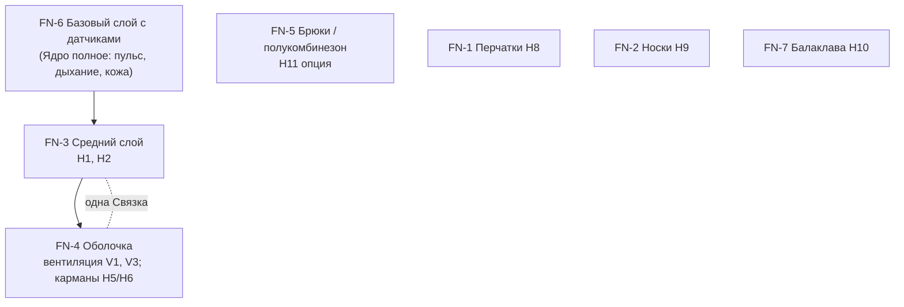

# 04. Function: ассортимент и конструкция изделий для лыж, сноуборда и экстрима

> **Версия:** v0.1 · **Дата:** 2026-11-28 · **Статус:** черновик; конструкция — **[Гипотеза]** до горных испытаний
> **Отдел:** Дизайн · **Источники:** [99-sources.md](99-sources.md) · **Платформа:** [02-platform-construction.md](02-platform-construction.md) · **Карта зон:** [assets/zones-function.svg](assets/zones-function.svg)
> **Ассортимент и цены** — [../02-product/lines-and-assortment.md §3](../02-product/lines-and-assortment.md).

## Резюме

- **Главный враг — цикл «пот на спуске, холод на подъёмнике»** [../03-science/02 §4.1](../03-science/02-thermoregulation-comfort.md). Конструкция отвечает двумя режимами: «Спуск» (вентиляция открыта, нагрев выключен) и «Подъёмник» (вентиляция закрыта, нагрев торса и кистей).
- **Система слоёв на одной Связке:** базовый слой FN-6, средний FN-3, оболочка FN-4, брюки FN-5, перчатки FN-1, носки FN-2, балаклава FN-7.
- **Лавинная безопасность заложена в крой:** чистая зона груди без нагревателей и магнитов, Связка справа внизу, «Лавинный режим» одним действием [D3][D4].
- **Первая волна Function (по Стратегии):** FN-1 перчатки и FN-2 носки [../02-product/launch-line-recommendation.md §3].

---

## 1. Система слоёв

**Где Ядро.** Пульс и дыхание снимаются только с плотно прилегающего базового слоя [../03-science/01 §1](../03-science/01-sensing-from-textile.md). Поэтому полное Ядро живёт на FN-6, а Тепло Function — в Порту среднего слоя или оболочки. Ядро и Тепло общаются по BLE, когда они в разных слоях **[Гипотеза: 04-tech подтверждает, что управление нагревом может идти по радио с аппаратной защитой в Тепле]**.

## 2. Изделия

### FN-1 · Перчатки и варежки — герой 1

| Параметр | Решение |
|---|---|
| Варианты | перчатка 5 пальцев и варежка «лобстер» (3 пальца) **[Гипотеза: варежка теплее, проверить спрос]** |
| Нагрев | H8 тыльная сторона и все пальцы, включая кончики; предел 40–41 °C |
| Батарея | в манжете с тыльной стороны, свой модуль ≈ 7,4 В [R-S42]; ячейки у запястья, а не на ладони, чтобы держать палки |
| Датчики | температура кожи тыльной стороны и одного пальца; в MATUTA — предупреждение о риске обморожения пальцев [../03-science/02 §2.1](../03-science/02-thermoregulation-comfort.md) |
| Корона | на манжете, крупная (22 мм), с рельефом: нажимается другой рукой в перчатке |
| Лавинный режим | физический выключатель на батарее; UIAA требует снимать перчатки с подогревом при поиске [D4] → крепление поводком к запястью, чтобы снять и не потерять |
| Конструкция | съёмный внутренний вкладыш с нагревателем + внешняя кожаная/мембранная перчатка; вкладыш сушится на «Станции Титана» [../04-tech/08 §4] |
| Уход | внешняя — по коже; вкладыш — машинная стирка без батареи |

### FN-2 · Носки и стельки — герой 1

| Параметр | Решение |
|---|---|
| Нагрев | H9 пальцы стопы, сверху и снизу носка **[Гипотеза: сверху — меньше давления на нагреватель]** |
| Батарея | на манжете носка над краем ботинка (не внутри ботинка, чтобы не давила); Avalanche Canada допускает носки с подогревом в режиме передачи, но их выключают при поиске [D3] |
| Материал | меринос с полиамидом, компрессия лёгкая, без жгута на манжете ([../03-science/05 §2.2](../03-science/05-safety-contraindications.md)) |
| Альтернатива | стелька с батареей в пятке — для тех, кто не любит манжету; общий язык жестов |
| Безопасность | диабет с нейропатией → носки отключаются при онбординге; [Sci: Bus2024] |

### FN-3 · Утепляющий средний слой

- Лёгкая куртка с синтетическим утеплителем зонами: плотнее на груди и пояснице, тоньше на спине под рюкзаком **[Гипотеза]**.
- Нагрев H1 и H2; **без H3/H4 на груди** — чистая зона под лавинный датчик ([02 §5](02-platform-construction.md)).
- Порт — внутренний карман справа на талии (Тепло Function 37–50 Вт·ч [../04-tech/03 §1.3]).
- Проницаемые боковые вставки из флиса: средний слой на спуске не должен копить пот.

### FN-4 · Мембранная оболочка

| Параметр | Решение |
|---|---|
| Силуэт | свободная куртка с капюшоном под шлем, длина ниже ягодиц, юбка от снега |
| Материал | 3-слойная мембрана без PFAS [N30]; колорвеи «снег + чёрный», «ледник», сигнальный янтарь |
| Вентиляция | V3 подмышки (двусторонние молнии с крупными пуллерами для перчаток); V1 спина — клапан + место под пьезо- или микровентилятор v2 [N11][../04-tech/07 §2.2] |
| Нагрев | H5/H6 карманы; торс — через FN-3. В самой оболочке нагрева торса нет **[Решение дизайна: оболочку носят и весной без утеплителя]** |
| Порт | внутренний карман справа на талии (если без FN-3) |
| Корона | левое плечо спереди, выше обвязки лавинного датчика **[Гипотеза: проверить расстояние ≥ 20 см от Короны с мембраной до датчика — в Короне нет магнита]** |
| Карман для лавинного датчика | внутренний на груди слева с петлёй для шнура; без металла рядом |
| Радиационное охлаждение | v2: панели плеч и капюшона из радиационно-охлаждающей ткани для весеннего солнца [N27] |

### FN-5 · Брюки и полукомбинезон

- Нагрев H11 на бёдрах (опция) и H2 поясница у полукомбинезона.
- Порт — внутренний карман на правом бедре спереди; не на ягодицах (падение) и не на коленях (сгиб).
- Вентиляция — молнии по внутренней стороне бедра.

### FN-6 · Базовый слой с датчиками

- Мериносовая смесь, облегающий крой, отдельные лекала М/Ж [Sci: Textile-ECG-2025].
- Электроды ЭКГ — 2–3 зоны под грудью; датчик дыхания — растяжение на нижних рёбрах ([../04-tech/03 §4]: базовый слой с ЭКГ).
- Ядро — сбоку слева на рёбрах, как в Sport ([05-sport-base.md](05-sport-base.md)); лавинный датчик на груди — Ядро без магнитов в радиусе 20 см **[вопрос к 04-tech: в Ядре нет магнита, кроме разъёма; разъём Sport-типа на базовом слое — проверить на помехи]**.
- Вентиляционная вставка «треугольник бра» в женской модели [D2]; центр спины — сетка [D1].

### FN-7 · Балаклава и подшлемник

- Тонкая, под шлем; H10 по лбу и ушам; батарея — плоская у затылка, не под шлемом в зоне удара **[Гипотеза: согласовать с требованиями шлемов]**.
- Зона рта — дышащая сетка, без нагрева (конденсат).

### FN-8 · Экспедиционная парка

- По запросу, позже (Стратегия). Дизайн откладывает до появления данных по FN-3/FN-4.

## 3. Режимы, которые видит человек

| Режим | Что происходит в одежде | Как включается |
|---|---|---|
| **Спуск** | нагрев торса снижен; если открыты молнии V1/V3 — нагрев выключен | автоматически по пульсу и движению (IMU) [../04-tech/07 §3] |
| **Подъёмник** | нагрев H1, H2, H5/H6 и перчаток включается | автоматически при неподвижности после нагрузки [../03-science/02 §4.2] |
| **Аварийный** | максимально долгий безопасный обогрев торса, экономия батареи на часы | падение и неподвижность; кнопка; MATUTA [../03-science/02 §4.3] |
| **Лавинный** | всё выключено: нагрев, радио, свет | удержание Короны 5 с; механический выключатель на Связке и батареях перчаток |

Датчик, который знает, открыты ли молнии V1/V3, — магнитный геркон у бегунка или проводящий контакт **[Гипотеза для 04-tech; в зоне груди магниты запрещены — V3 подмышки вне её]**.

## 4. Порядок разработки (дизайн)

| Шаг | Что | Когда, гипотеза |
|---|---|---|
| 1 | FN-1 перчатки и FN-2 носки: эскизы, макеты батарей, вкладыш | этап 1–2, на общей платформе с SC-5 (перчатки SC и FN — одна платформа двух уровней [../02-product/lines-and-assortment.md §4]) |
| 2 | FN-6 базовый слой (с командой Sport) | этап 2 |
| 3 | FN-3, FN-4, FN-5, тест «спуск — подъёмник» 3–4 ч в горах [../03-science/02 §5] | этап 2–3 |
| 4 | Лавинный тест с тремя моделями датчиков | до продаж оболочки |
