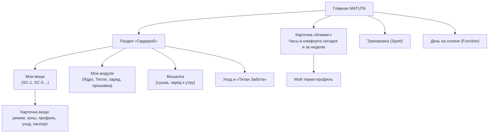

# 06. UX: управление на изделии и связка с MATUTA

> **Версия:** v0.1 · **Дата:** 2026-11-28 · **Статус:** черновик; сценарии и пороги — **[Гипотеза]** до юзабилити-тестов
> **Отдел:** Дизайн (UX) · **Источники:** [99-sources.md](99-sources.md)
> **Входы:** архитектура и BLE-сервисы ([../04-tech/02-reference-architecture.md](../04-tech/02-reference-architecture.md)), вешалка ([../04-tech/08-smart-hanger.md](../04-tech/08-smart-hanger.md)), метрика «Часы в комфорте» ([../00-vision/north-star.md §2](../00-vision/north-star.md)), безопасность ([../03-science/05-safety-contraindications.md](../03-science/05-safety-contraindications.md)).

## Резюме

- **Главный сценарий — никакого сценария.** Одежда работает на автопилоте и без телефона; MATUTA настраивает, предупреждает и показывает итог. Базовые функции работают без интернета и подписки [../00-vision/north-star.md §6].
- **Одна кнопка «Корона», четыре жеста, один язык света** на всех изделиях трёх линеек.
- **В MATUTA появляется раздел «Гардероб»** (вещи, модули, вешалка, уход) и карточка «Климат» на главном экране с «Часами в комфорте».
- **Безопасность встроена в онбординг:** три вопроса о здоровье сами ограничивают подогрев по таблице противопоказаний 03-science.
- **Спокойные данные:** тренды вместо секундных цифр, не больше 2 несрочных уведомлений в день, чтобы не вызывать тревогу от данных [Sci: Baron2017] **[Гипотеза: порог]**.

---

## 1. Принципы UX

| # | Принцип | Что значит на практике |
|---|---|---|
| 1 | **Автопилот по умолчанию** | после покупки вещь сразу работает в режиме «Авто», без настройки |
| 2 | **Работает без телефона** | нагрев, сброс тепла, цвет зоны и безопасность считаются на модуле ([../04-tech/02 §1]) |
| 3 | **Ручное важнее автоматики, но не важнее безопасности** | ручной приоритет выше авто, с ограничением максимальной температуры ([../03-science/02 §3.3]) |
| 4 | **Одно и то же везде** | жесты Короны и цвета света одинаковы в жилете, перчатках, оболочке и топе |
| 5 | **Спокойные данные** | итог дня и тренд, а не поток цифр; не показывать «плохой» статус без совета ([../03-science/05 §5]) |
| 6 | **Приватность по умолчанию** | цвет пульса выключен; сырые сигналы не хранятся ([../04-tech/02 §1], правило MATUTA [T-S36]) |

## 2. Управление на изделии

### 2.1 Жесты Короны

| Жест | Smart Casual, Function | Sport (на Ядре) |
|---|---|---|
| 1 нажатие | показать уровень (свет 2 с) и заряд | показать заряд |
| 2 нажатия | «Буст» на 10 мин, затем возврат в Авто **[Гипотеза: длительность]** | начать или закончить тренировку |
| Удержание 2 с | включить или выключить нагрев | включить или выключить свет зоны |
| Удержание 5 с | **Лавинный режим** (Function): выключить всё | — |

Перчатки и носки повторяют те же жесты на своей кнопке.

### 2.2 Язык света (янтарное кольцо Порта и линия Короны)

| Состояние | Свет | Вибрация **[Гипотеза: нужен вибромотор в Ядре — вопрос к 04-tech]** |
|---|---|---|
| Авто, тепло не нужно | не светится | — |
| Авто, греет | 1–3 сегмента янтаря, ровно | — |
| Буст | 3 сегмента, медленное «дыхание» | 1 короткий импульс |
| Низкий заряд (< 15 %) | 1 сегмент мигает раз в 5 с | 2 импульса один раз |
| Перегрев или ошибка датчика, нагрев отключён | короткие красные вспышки 3 раза | 3 импульса |
| Лавинный режим | 1 белая вспышка и полное выключение | длинный импульс |
| Модуль вставлен / вынут | янтарь разгорается / гаснет за 1 с | — |

Ночью и в темноте свет снаружи не виден: кольцо Порта внутри, линия Короны под планкой ([02 §3.3](02-platform-construction.md)).

## 3. MATUTA: структура и ключевые сценарии

MATUTA — нативное Android-приложение (Kotlin, Compose) [T-S36]. Одежда подключается модулем `:integration:garment`, функция «Тепло» — модулем `:feature:thermal` ([../04-tech/02 §5.2]). Дизайн добавляет к этому:

### 3.1 Знакомство с вещью (первый запуск)

| Шаг | Экран | Цель **[Гипотеза]** |
|---|---|---|
| 1 | Вставить Связку в Порт → телефон показывает системное окно сопряжения Companion Device Manager ([../04-tech/02 §5.2]) | ≤ 60 с от коробки до работающей вещи |
| 2 | Вещь сама называет себя (ID в доке): «Жилет SC-1, размер M» | без ручного выбора модели |
| 3 | Три вопроса термо-профиля (§3.2) | ≤ 30 с |
| 4 | «Готово. Вещь работает сама. Корона — одна кнопка на всё» + анимация жестов | — |

Повторное знакомство с той же Связкой в другой вещи — без шагов 3–4.

### 3.2 Термо-профиль и безопасность

Три вопроса:
1. «Вы скорее мёрзнете или скорее перегреваетесь?» — сдвиг цели микроклимата на ±1 °C **[Гипотеза]**.
2. «Чаще мёрзнут руки, ноги или всё тело?» — приоритет зон.
3. «Есть ли у вас что-то из списка?» — диабет с нейропатией, болезнь периферических артерий, беременность, кардиостимулятор, повреждение спинного мозга или РС, синдром Рейно.

Ответ на вопрос 3 автоматически применяет ограничения из таблицы 03-science ([../03-science/05 §4](../03-science/05-safety-contraindications.md)): например, при диабете с нейропатией — только торс, низкий уровень, стельки и носки отключены [Sci: Bus2024]; при кардиостимуляторе — биоимпеданс в Sport выключен. Ответы хранятся только на устройстве, как прочие данные о здоровье в MATUTA [T-S36] **[Решение дизайна; формулировки утверждает 06-ops-legal]**.

### 3.3 Утро: «Готов к выходу»

- MATUTA знает календарь и прогноз. За 5–10 мин до выхода «Вешалка» прогревает куртку от сети, а Связка дозаряжается с хранения 50–60 % до 100 % ([../04-tech/08 §3](../04-tech/08-smart-hanger.md)).
- В шторке Android — уведомление с прогрессом «Прогрев к выходу · 6 мин» на основе прогресс-уведомлений Android 16 (`Notification.ProgressStyle`) [D7].
- Если вещь не на вешалке и заряд низкий — одно напоминание вечером, а не утром.

### 3.4 День: «Климат» и «Часы в комфорте»

- Карточка на главной: «Сегодня в комфорте 94 % времени на улице» — так, как в сценарии Северной звезды [../00-vision/north-star.md §4].
- Раз в неделю — один вопрос «Было ли вам комфортно на этой неделе?» (часть метрики [../00-vision/north-star.md §2]).
- Детализация по тапу: когда и где было холодно, сколько работал нагрев, что сделала вещь сама (например, «в метро нагрев снят за 8 с»).
- Предупреждение о ветро-холодовом индексе и риске обморожения открытой кожи — до выхода, если прогноз ниже порога ([../03-science/02 §2.3](../03-science/02-thermoregulation-comfort.md)).

### 3.5 День на склоне (Function)

| Элемент | Что показывает |
|---|---|
| Прогресс-уведомление «День на склоне» [D7] | заряд Тепла и перчаток против времени закрытия подъёмников: «Хватит до 16:30» |
| Автоматические режимы | «Спуск» и «Подъёмник» — без действий человека ([04-function.md §3](04-function.md)) |
| Предупреждения | обморожение пальцев по температуре кожи; ветро-холодовой индекс; низкий заряд с запасом 1 ч |
| Аварийный режим | падение и неподвижность → обогрев торса + сигнал контакту ([../03-science/02 §4.2–4.3]) |
| Лавинный режим | крупная кнопка на экране блокировки + удержание Короны 5 с; подсказка UIAA «снимите перчатки с подогревом» при поиске [D4] |
| Итог дня | время на холоде, спуски, средний пульс по базовому слою |

### 3.6 Тренировка (Sport, базово)

- Старт тренировки двойным нажатием на Ядре или в MATUTA; пульс уходит по стандартному Heart Rate Service и виден в часах и приложениях ([../04-tech/02 §3]).
- Настройка цвета зоны: режим приватности ([05-sport-base.md §3.3](05-sport-base.md)), границы зон (по формуле Танаки, затем автокоррекция [../03-science/03 §2.1](../03-science/03-sport-physiology.md)).
- После тренировки: «Потеря влаги ≈ 0,9 л. Выпейте 1,2–1,5 л» — с калибровкой взвешиванием на первых 2–3 тренировках ([../03-science/03 §3](../03-science/03-sport-physiology.md)).

### 3.7 Уход и сервис

- После 10 носок без сушки или пропитки — мягкая подсказка «повесьте на Вешалку» **[Гипотеза: порог]**.
- Перед стиркой: короткая анимация «вынь Связку → отстегни подклад → закрой заглушку».
- Диагностика с Вешалки: «Сопротивление зоны H1 выросло на 9 %. Замена назначена в «Титан Заботе»» — сообщение из сценария Северной звезды; порог тревоги дрейфа нагревателя ±10 % ([../04-tech/08 §3](../04-tech/08-smart-hanger.md)).
- Карточка вещи хранит цифровой паспорт: состав, страна, ремонты, перепродажа — задел под будущий DPP ЕС [D5][D6].

## 4. Уведомления: политика

| Класс | Примеры | Лимит **[Гипотеза]** |
|---|---|---|
| Безопасность | перегрев, обморожение, падение, лавинный режим | без лимита, звук и вибрация |
| Время | «прогрев к выходу», «день на склоне» | прогресс-уведомление, без звука [D7] |
| Уход | заряд, сушка, сервис | ≤ 1 в день, вечером |
| Итог | «Часы в комфорте», неделя | ≤ 1 в день |

## 5. Доступность

- Все кнопки и жесты работают в перчатках; экранные цели в MATUTA ≥ 48 dp **[Гипотеза: по практике Android]**.
- Никакая информация не передаётся только цветом: зоны пульса — цвет + число сегментов; ошибки — цвет + ритм + вибрация [D8].
- Язык интерфейса — русский и английский на старте; рынок глобальный ([../00-vision/titan-persona.md §1]).

## 6. Открытые вопросы

1. **iOS.** MATUTA сейчас только на Android [T-S36]; одежда продаётся глобально. Без iOS-приложения часть покупателей Smart Casual получит только автономный режим. Нужно решение основателя и Финансов ([../04-tech/02 §6]).
2. **Вибромотор в Ядре** — для подтверждения жестов в толстой одежде (вопрос к 04-tech).
3. **Где живёт «Гардероб»** — внутри MATUTA (рекомендация дизайна: один дом для тела и одежды) или в отдельном приложении бренда одежды.

## 7. Юзабилити-тесты этапа 0

| # | Тест | Участники | Критерий **[Гипотеза]** |
|---|---|---|---|
| 1 | Знакомство с вещью (прототип в Figma + макет Связки) | 12 человек, сегмент «Городской Титан» | ≥ 10 из 12 без помощи за ≤ 60 с |
| 2 | Жесты Короны в зимних перчатках | 20 человек | ≥ 95 % верных жестов |
| 3 | Понимание языка света | 20 человек, после 1 мин обучения | ≥ 90 % верно называют состояние |
| 4 | Цвет зоны и приватность в зале | 2 клуба HYROX (тест T3 Стратегии) | атлеты сами выбирают режим; ≥ 80 % понимают сегменты |
