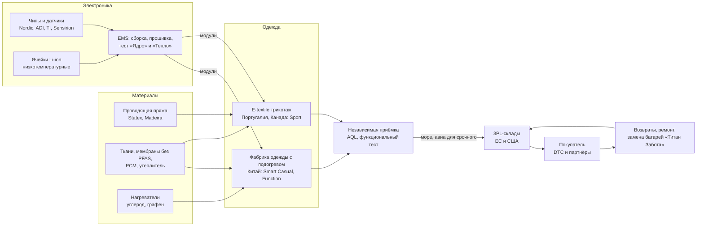

# 06-ops-legal · 03. Цепочка поставок, логистика, пошлины

Версия 0.1 · 2026-11-28 · Отдел «Операции и право» · Источники — [99-sources.md](99-sources.md).

## 1. Схема

**Принцип:** прошивку записывает EMS по нашему подписанному образу, ключи подписи у фабрик не хранятся (см. [T-ARCH] — MCUboot с проверкой подписи).

## 2. Сроки первого сезона [Гипотеза: по срокам фабрик]

Зимний сезон (продажи с октября в северном полушарии). Обратный отсчёт от отгрузки на склады в начале сентября:

| Этап | Длительность | Основание |
|---|---|---|
| RFQ, выбор 2–3 фабрик, NDA | 4–6 недель | — |
| Образцы ODM / OEM | 1–3 недели на итерацию, 2–3 итерации | 5–7 раб. дней (ODM), 10–15 (OEM), 14–21 день [O1][O2][O3] |
| Сертификационные испытания (параллельно с образцами) | 6–10 недель | **[Гипотеза: типичная загрузка лабораторий]**, см. [04-certification.md](04-certification.md) |
| Пилотная партия 100–300 шт. | 4–6 недель | серия 25–50 дней [O1] |
| Основная серия | 8–12 недель до первой отгрузки OEM | [O3] |
| Морская доставка в США или ЕС | 25–35 дней; авиа 5–7 дней | [O3] |

**Итог:** от старта RFQ до товара на складе — **7–9 месяцев**. Чтобы успеть к сезону осень 2027 г., RFQ надо начать не позже января 2027 г. **[Расчёт по таблице]**.

## 3. Перевозка батарей

Литий-ионные батареи — опасный груз. Важные правила IATA с 01.01.2026 [O22][O23]:

| Способ упаковки | Номер ООН и инструкция | Правило заряда (SoC) |
|---|---|---|
| Батарея внутри изделия (модуль «Тепло» установлен в куртку) | UN 3481, PI 967 | 30 % заряда или индикация ≤ 25 % рекомендованы, но не обязательны [O22][O23] |
| Батарея в одной коробке с изделием (отдельно лежит) | UN 3481, PI 966 | Не больше 30 % обязательно с 01.01.2026 (Section I; в Section II — для батарей больше 2,7 Вт·ч) [O22] |
| Батареи отдельно (запчасти, «Титан Забота») | UN 3480, PI 965 | Не больше 30 %; запрещены на пассажирских самолётах [O22] |

- Лимиты на упаковку: PI 966/967 Section I — 5 кг (пассажирский) и 35 кг (грузовой), Section II — 5 кг [O22].
- Сводка испытаний UN 38.3 обязательна у производителя и каждого следующего дистрибьютора, можно дать ссылкой или QR-кодом [O22].
- **Решение:** отгружать модули «Тепло» с зарядом ≤ 30 % во всех вариантах упаковки; это требование записываем в спецификацию EMS. Штучные батареи для сервиса возим морем или наземным транспортом **[Решение отдела]**.

## 4. Пошлины США (на 28.11.2026)

| Мера | Что сейчас | Источник |
|---|---|---|
| Тарифы по IEEPA (Китай, Вьетнам, «взаимные») | Верховный суд 20.02.2026 (Learning Resources v. Trump) решил, что IEEPA не даёт права на эти тарифы; сбор прекращён 24.02.2026, портал возвратов с 20.04.2026 | [O44][O45][O43] |
| Раздел 122 (временная надбавка) | С 24.02.2026 на 150 дней, истёк 24.07.2026; ставка 10 % по [O43][O44], 15 % по [O45] — расхождение | [O43][O44][O45] |
| Раздел 301, принудительный труд | С 24.07.2026 надбавка 10 % или 12,5 %; Китай и Вьетнам — в группе 12,5 % поверх других пошлин | [O43] |
| Раздел 301, Китай (2018) | 7,5 % или 25 % на широкие группы товаров; исключения продлены до 09.01.2027 | [O43] |
| Раздел 301, расследование по Вьетнаму (IP) | Начато 29.05.2026, решение до 28.02.2027 | [O43] |
| Беспошлинный ввоз мелких посылок (de minimis) | Для Китая и Гонконга отменён 02.05.2025, для всех стран приостановлен 29.08.2025 | [O44] |
| Средняя фактическая ставка на одежду из синтетики (MMF) | 19 % (01.2025) → пик 36 % (10.2025) → 25 % (06.2026) | [O44] |

**Выводы для «Титана»:**
1. Модель DTC с посылками из Китая напрямую в США больше не работает без пошлины — нужен склад в США и ввоз партиями **[Анализ по O44]**.
2. Китай и Вьетнам сейчас в одной группе по разделу 301 (12,5 %) [O43]; по Вьетнаму идёт новое расследование. Сдвиг производства во Вьетнам ради пошлин США сейчас выгоды не даёт **[Анализ]**.
3. Нужна классификация по ТН ВЭД для комплекта: куртка (глава 62) и модуль электроники могут облагаться по-разному. Решение — у таможенного брокера до первой отгрузки **[Гипотеза]**.

## 5. Себестоимость с доставкой (landed cost) — пример [Расчёт]

Комплект Smart Casual «пуховик + Ядро Lite + Тепло»: FOB 78–130 $, середина 104 $ [T-BOM].

| Статья | США | ЕС |
|---|---|---|
| FOB (середина) | 104 $ | 104 $ |
| Пошлина | 25 % — средняя фактическая ставка по синтетике [O44] **[Гипотеза: применима к нашему коду]** → 26 $ | 12 % **[Гипотеза: типичная ставка ЕС на верхнюю одежду, проверить по TARIC]** → 12,5 $ |
| Фрахт морем и страховка | 3 $ **[Гипотеза]** | 3 $ **[Гипотеза]** |
| Приёмка, маркировка, сертификация в пересчёте на 10 000 шт. | 2 $ **[Гипотеза]** | 2 $ **[Гипотеза]** |
| **Итого на складе** | **≈135 $** | **≈121,5 $** + НДС при продаже |

Разница США — ЕС ≈ 13,5 $ на комплект. Для Sport, если шьём в Португалии, пошлины ЕС нет; для США — нужна оценка по правилам происхождения **[Гипотеза]**. Цифры передаются в `07-finance` как вход, а не как результат.

## 6. Обратная логистика и сервис
- Гарантия 12–24 месяца на нагрев и батареи — за счёт фабрики по договору ([02-contract-manufacturers.md](02-contract-manufacturers.md) §6).
- Модули съёмные: в ремонт едет модуль, а не куртка. Это снижает стоимость сервиса и соответствует требованию съёмности батарей ЕС [O20].
- Сбор и переработка батарей: в ЕС действует расширенная ответственность производителя за батареи с 18.08.2025 [O20]; нужны договоры с системами сбора в каждой стране продаж ([08-esg.md](08-esg.md)).
