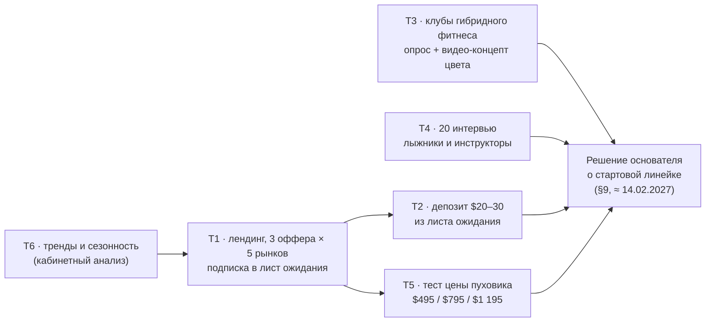

# 01. Тесты спроса: дизайн, бюджет, метрики, пороги решения

> **Версия:** v0.1 · **Статус:** на утверждение основателю · **Дата:** 2026-11-28
> **Владелец:** Маркетинг и выход на рынок (08-gtm) · **Источники:** [99-sources.md](99-sources.md) `[G#]`, реестр Стратегии `[S#]`, документы других отделов `[P#]`
> **Основа:** шесть тестов T1–T6 из [01-research/demand-signals.md §4](../01-research/demand-signals.md) (PR #3). Здесь они доведены до исполнения.

## Резюме

- **Задача тестов:** за 10 недель (7 декабря 2026 — 14 февраля 2027) получить данные, по которым основатель выбирает стартовую линейку. Сейчас по оценке Стратегии лидирует Smart Casual (3,90 из 5), Function — 3,45, Sport — 2,80 [Оценка: P3]. Тесты могут этот порядок перевернуть.
- **Бюджет: ≈ $33 000**, из них ≈ $17 500 — реклама, остальное — стимулы респондентам, инструменты и резерв 20 % [Оценка, §8].
- **Главная метрика — депозит, а не подписка.** Подписка ничего не стоит человеку, депозит $20–30 стоит. Решение по линейке на 35 % определяется долей депозитов из листа ожидания (§9).
- **Поправка к PR #3.** Порог T1 «лид ≤ $5 при конверсии ≥ 5 %» недостижим: он требует цены клика ≤ $0,25, а медиана в США — $0,60 [Факт: G2]. Новые пороги привязаны к рыночным медианам (§2.4).
- **Три условия до старта (неделя 0):** юридическая проверка депозита (06-ops-legal), патентная заявка до показа цвета по пульсу (06-ops-legal), запрет на медицинские формулировки (03-science). Без них тесты не запускаем.

---

## 1. Общая схема

| № | Тест | Линейка | Сроки | Бюджет | Главная метрика |
|---|---|---|---|---|---|
| T1 | Лендинг и реклама | все | 7–27.12.2026 | $10 000 | стоимость подтверждённого лида (CPL), конверсия лендинга |
| T2 | Депозит | все | 4.01–7.02.2027 | $3 000 | доля депозитов из листа |
| T3 | Клубы гибридного фитнеса | Sport | 5.01–7.02.2027 | $6 000 | доля «точно куплю» по $195 |
| T4 | Интервью со склона | Function | 14.12.2026–7.02.2027 | $2 000 | повторяющиеся боли, готовность платить |
| T5 | Тест цены | Smart Casual | 11.01–7.02.2027 | $4 500 | маржа на посетителя по каждой цене |
| T6 | Тренды и сезонность | все | 30.11–20.12.2026 | $500 | индекс сезонности по рынкам |

Сроки — [Оценка]: 10 недель укладываются в окно PR #3 (6–10 недель) и совпадают с пиком зимы в Северном полушарии. Это важно: интерес к теплу зимой выше, а летний тест занизил бы спрос на Smart Casual и Function [Гипотеза: проверяет T6 по Google Trends].

## 2. T1 — лендинг с тремя офферами

### 2.1. Что показываем

Три оффера — по одному на линейку. Тексты опираются на тизер «ТВОЙ КЛИМАТ. ВЕЗДЕ.» [P6] и позиционирование из [02-positioning-segments-markets.md](02-positioning-segments-markets.md).

| Оффер | Линейка | Заголовок (RU / EN) | Герой на лендинге |
|---|---|---|---|
| A | Smart Casual | «Минус 25. Тебе тепло. Сама.» / *Minus 25. You're warm. Automatically.* | жилет SC-1 и пуховик SC-2 |
| B | Sport | «Твоя зона пульса — видна всем в зале» / *Your heart-rate zone, visible on you* | компрессионный топ SP-1, бра SP-2 |
| C | Function | «Весь день на склоне. Тёплые руки и ноги» / *All day on the mountain. Warm hands and feet* | перчатки FN-1, носки FN-2 |

Правила текста [Факт: P2, P6]:
- никаких медицинских обещаний («лечит», «диагностирует», «предупреждает о болезни»);
- не показываем датчики, провода и устройство цвета до патентной заявки;
- везде одно обещание бренда: «держит твой комфорт сама»; цифры и технологии — ниже по странице.

### 2.2. Рынки и ячейки

5 рынков × 3 оффера = **15 ячеек**. Рынки взяты из PR #3, их выбор объяснён в [02-positioning-segments-markets.md §4](02-positioning-segments-markets.md).

| Рынок | Язык | CPM, $ [Факт: G1] | Ожидаемая цена клика, $ [Гипотеза] |
|---|---|---|---|
| США | EN | 10,50–16,80 | 0,90–1,50 |
| Германия | DE | 7,60–12,40 | 0,70–1,20 |
| Северные страны (SE, NO, DK, FI) | EN | 6,60–13,00 | 0,70–1,20 |
| Япония | JA | 7,20–11,80 | 0,70–1,20 |
| Русскоязычная аудитория вне РФ | RU | н/д (смешанное гео) | 0,50–1,00 |

Цена клика выше медианы США $0,60–0,71 [Факт: G2], потому что: новый рекламный аккаунт без истории; Instagram дороже Facebook на 15–25 % [Факт: G1]; декабрь — сезон распродаж [Гипотеза].

### 2.3. Объём выборки и бюджет

- **400 посещений лендинга на ячейку.** При конверсии 10 % погрешность ±2,9 п.п. (95 %), этого хватает, чтобы отличить «зелёный» от «красного» [Оценка: 1,96 × √(0,1 × 0,9 / 400)].
- 15 ячеек × 400 = 6 000 посещений × ~$1,20 = **$7 200**; плюс ~30 % на фазу обучения алгоритма и замену слабых креативов → **≈ $10 000** [Оценка].
- Кампании с целью «трафик на лендинг», равный бюджет на ячейку, 3 креатива на оффер (статичный кадр, карусель, 15-секундное видео из тизера [P6]).

### 2.4. Метрики и пороги

| Метрика | Как считаем | Зелёный | Жёлтый | Красный | Основание |
|---|---|---|---|---|---|
| **CPL** — стоимость подтверждённого лида | расход ÷ подписки с подтверждением e-mail (double opt-in) | ≤ $8 | $8–16 | > $16 | медиана CPL «спорт и отдых» $15,49 [Факт: G2]; зелёный — вдвое лучше рынка |
| **CVR лендинга** | подтверждённые подписки ÷ посещения | ≥ 12 % | 6–12 % | < 6 % | медиана CVR лид-кампаний 6,75–8,54 % [Факт: G2]; лендинг должен быть лучше медианы |
| CTR ссылки (гигиена креатива) | клики ÷ показы | ≥ 1,5 % | 1,0–1,5 % | < 1,0 % | медиана CTR одежды 1,51 % [Факт: G2] |
| Анкета после подписки | доля заполнивших 3 вопроса | ≥ 50 % | 30–50 % | < 30 % | [Гипотеза] |

**Почему меняем порог PR #3** [Оценка]: CPL = CPC ÷ CVR. При CVR 5 % лид за $5 требует CPC $0,25 — это в 2,4 раза дешевле медианы США $0,60 [Факт: G2]. Такого не бывает на холодном трафике, и тест «провалил» бы все три линейки.

Сравнение между линейками важнее абсолютных цифр: если CPL одного оффера **вдвое ниже** остальных на 3+ рынках из 5, это сильный сигнал (правило PR #3 «лид на лыжи в 2 раза дешевле — старт с Function» сохраняется) [Факт: P3].

### 2.5. Анкета после подписки (3 вопроса)

1. Что из этого вы купили бы первым? (жилет / пуховик / перчатки / топ для тренировок / перчатки и носки для лыж)
2. Что вы уже носите? (WHOOP / Oura / Garmin / Apple Watch / нагрудный ремень / одежду с подогревом / ничего)
3. Сколько дней в году вам холодно на улице? (< 30 / 30–90 / > 90)

Ответы дают сегменты для T2 и связку с MATUTA (кто уже носит WHOOP — первый круг экосистемы [Факт: S20]).

## 3. T2 — депозит

### 3.1. Механика

| Параметр | Решение | Почему |
|---|---|---|
| Размер | $30 для Smart Casual и Function, $20 для Sport | ≈ 10 % цены героя: SC-1 $295–395, FN-1 $245–395, SP-1 $145–245 [Факт: P3] |
| Что получает человек | «цена основателя» −20 % от будущей розницы и место в первой партии; депозит засчитывается в цену | [Гипотеза] |
| Возврат | полностью и в любой момент до отгрузки, одной кнопкой, за ≤ 7 рабочих дней | FTC: возврат за 7 рабочих дней [Факт: G8]; ЕС: кнопка отказа обязательна с 19.06.2026 [Факт: G13] |
| Юридическая форма | **возвратная бронь права купить**, а не покупка товара; без обещанной даты отгрузки, только «ожидаемо: зима 2027/28» | частичная оплата запускает правило FTC о 30 днях; «сухой тест» допустим без обещания срока и с возвратом [Факт: G8]. Финальную формулировку утверждает 06-ops-legal |
| Платёжный инструмент | Stripe или Shopify с отдельным товаром «бронь» | комиссия обработки ~3 % [Факт: G3] |

### 3.2. Кому и как

- Приглашение получают все подтверждённые подписчики T1: серия из 3 писем за 14 дней, окно депозита — 21 день.
- Ретаргетинг посетителей лендинга и похожие аудитории — **$3 000** [Оценка].
- Отдельная группа: русскоязычное сообщество «Здоровья Титана» (первый круг, [03-channels.md §5](03-channels.md)). Считаем отдельно, чтобы тёплая аудитория не завысила общий результат.

### 3.3. Пороги

| Метрика | Зелёный | Жёлтый | Красный | Основание |
|---|---|---|---|---|
| Доля депозитов из листа (за 21 день) | ≥ 5 % | 2–5 % | < 2 % | 1–5 % списка становятся бэкерами [Факт: G4]; у физических продуктов конверсия листа < 5 % [Факт: G6]. Зелёный — верх рынка |
| Депозитов на героя, штук | ≥ 100 | 40–100 | < 40 | [Гипотеза]: 100 — минимум для статистики и первого сообщества |
| Возвраты депозитов за время теста | < 15 % | 15–30 % | > 30 % | [Гипотеза] |

## 4. T3 — клубы гибридного фитнеса (Sport)

### 4.1. Важное ограничение

PUMA — официальный глобальный партнёр HYROX по одежде и обуви до 2030 года [Факт: G7]. Значит, **официальное партнёрство с лигой HYROX для одежды закрыто**. Работаем напрямую с независимыми клубами, тренерами и атлетами. В рекламе не используем товарный знак HYROX: пишем «гибридные фитнес-старты» [Гипотеза: проверка — 06-ops-legal].

### 4.2. Дизайн

| Параметр | Решение |
|---|---|
| Клубы | 15 клубов: 5 США, 5 Германия и Великобритания, 5 Северные страны и Австралия. Отбор — клубы с 150+ активными членами и собственным Instagram [Гипотеза] |
| Что показываем | 30-секундный видео-концепт: атлет в топе, цвет меняется по зонам 1–5. Показываем **эффект**, не устройство. Только после подачи патентной заявки (условие недели 0) |
| Опрос | 12 вопросов, онлайн, QR-код в клубе и рассылка клуба. Цель — n ≥ 300 (≈ 20 на клуб) |
| Цена | метод Gabor-Granger: $145 → $195 → $245 за топ (плюс модуль Ядро один раз) [Факт: G14 — метод; цены — P3] |
| Глубинные интервью | 15 коротких видеозвонков с тренерами клубов: нужен ли тренеру экран зоны группы (SP-6, B2B) |
| Стимулы | $10 подарочная карта за анкету (≈ $3 000); клубу — статус «клуб-основатель», бесплатный комплект в пилот и $200 за публикацию (≈ $3 000) [Оценка] |

### 4.3. Пороги

| Метрика | Зелёный | Жёлтый | Красный | Основание |
|---|---|---|---|---|
| «Точно куплю» по $195 (верхний вариант шкалы) | ≥ 30 % | 15–30 % | < 15 % | порог PR #3 [Факт: P3] |
| Цвет по пульсу в топ-2 важных функций | ≥ 40 % | 20–40 % | < 20 % | [Гипотеза]; 03-science сам называет ценность цвета «во многом маркетинговой» [Факт: P2] |
| Тренеры, которые хотят групповой экран | ≥ 8 из 15 | 4–7 | < 4 | [Гипотеза] |

Ответ «точно куплю» в опросах обычно выше реальной покупки [Гипотеза, общая практика исследований]. Поэтому T3 весит в решении только 15 %, а решающий сигнал Sport — депозит из T2.

## 5. T4 — интервью со склона (Function)

| Параметр | Решение |
|---|---|
| Кто | 20 человек: 7 — Альпы, 7 — Колорадо и Юта, 6 — Нисеко и Хоккайдо. В каждой группе ≥ 2 инструктора или гида и ≥ 2 фрирайдера. Катаются 10+ дней в сезон |
| Как | 40-минутный видеозвонок или голосовое интервью; ведёт ИИ-модератор по сценарию, основатель может присоединиться [Гипотеза: команда ИИ, §10] |
| Набор | платные панели респондентов и лыжные сообщества; стимул $75–100 → **$2 000** [Оценка] |
| Сроки | 14.12.2026–7.02.2027 — разгар сезона, боли свежие |
| Сценарий | последний холодный день на склоне; что носят на руках и ногах; сколько держит батарея; как стирают; лавинный датчик и подогрев; готовы ли заменить перчатки и носки на систему с общей батареей и автоматикой; цена комплекта $395 / $545 / $695 |

**Пороги:**

| Метрика | Зелёный | Жёлтый | Красный | Основание |
|---|---|---|---|---|
| Повторяющиеся боли (названы ≥ 50 % людей) | ≥ 3 | 2 | ≤ 1 | порог PR #3 «3 повторяющиеся боли» [Факт: P3] |
| Готовы заменить свои перчатки и носки на систему за ≥ $395 | ≥ 40 % | 20–40 % | < 20 % | [Гипотеза]; рынок платит $120–430 за одни перчатки [Факт: S42] |
| Фрирайдеры, для которых помехи лавинному датчику — «стоп» | — | — | — | не порог, а требование к продукту для 04-tech и 06-ops-legal [Факт: S42] |

## 6. T5 — тест цены пуховика (Smart Casual)

### 6.1. Дизайн

| Параметр | Решение |
|---|---|
| Что | пуховик SC-2 с автоматической терморегуляцией по трём ценам: $495 / $795 / $1 195 [Факт: P3] |
| Где | США и Германия; трафик делится случайно на 3 варианта лендинга |
| Объём | 3 цены × 2 рынка × 600 посещений = 3 600 посещений × ~$1,20 ≈ **$4 500** [Оценка] |
| Действие | депозит $30 сразу на странице (лист ожидания не нужен) |
| Дополнительно | 4 вопроса Van Westendorp в анкете T1 для всех линеек, n ≥ 300 на линейку (минимум метода — 100 [Факт: G14]) |
| Честность | каждый, кто внёс депозит, в итоге платит **наименьшую из тестовых цен** или свою, если она ниже. Это снимает риск несправедливой цены [Гипотеза: формулировку утверждает 06-ops-legal] |

### 6.2. Как выбираем цену

Цена-победитель — та, что даёт **наибольшую маржу на посетителя**:

> маржа на посетителя = (цена − себестоимость с доставкой) × доля депозитов на посетителя

Себестоимость комплекта «пуховик + Ядро Lite + Тепло» — $78–130 FOB [Факт: P1, Гипотеза ±30 %]. С пошлиной, доставкой, упаковкой и гарантийным резервом — ориентир $130–220 [Гипотеза: коэффициент ×1,7 до расчёта 07-finance и 06-ops-legal].

Пример [Оценка, цифры условные]: если при $495 депозит вносят 3,0 %, а при $795 — 2,0 %, то маржа на посетителя $9,6 против $12,4 при себестоимости $175. Цена $795 лучше, хотя конверсия ниже.

**Пороги:**

| Сигнал | Решение |
|---|---|
| При $795 или $1 195 маржа на посетителя не хуже, чем при $495 | премия за автоматику и дизайн доказана → премиальное позиционирование Smart Casual |
| Работает только $495 | Smart Casual уходит в доступный премиум; по правилу PR #3 растёт вес Function [Факт: P3] |
| Ни одна цена не дала ≥ 1 % депозитов на посетителя | красный сигнал по Smart Casual [Гипотеза] |

## 7. T6 — тренды и сезонность

- **Google Trends**, 5 лет, по странам из T1: *heated jacket, heated vest, heated gloves, smart clothing, ski gloves, HYROX* и их аналоги на немецком, японском, русском.
- **Particl** (если доступен по подписке): продажи ORORO и аналогов по месяцам [Факт: S34 — Particl уже используется Стратегией].
- **Результат:** индекс сезонности по месяцам и рынкам → окно запуска кампании в [04-launch-campaign.md](04-launch-campaign.md). Бюджет — до $500 [Оценка].

## 8. Бюджет

| Статья | Сумма, $ | Основание |
|---|---|---|
| T1 реклама | 10 000 | §2.3 |
| T2 ретаргетинг | 3 000 | §3.2 |
| T3 стимулы и клубы | 6 000 | §4.2 |
| T4 стимулы | 2 000 | §5 |
| T5 реклама | 4 500 | §6.1 |
| T6 данные | 500 | §7 |
| Инструменты: конструктор лендинга, рассылка, опросы, аналитика (2,5 мес.) | 1 000 | [Гипотеза] |
| Креатив: лицензии шрифтов и музыки, генерация | 500 | ИИ-производство, как в тизере [P6] |
| **Итого** | **27 500** | |
| Резерв 20 % | 5 500 | |
| **Всего** | **≈ 33 000** | [Оценка] |

Депозиты — не расход: это деньги клиентов на отдельном счёте до отгрузки или возврата [Гипотеза: учёт определяет 07-finance].

## 9. Правило решения

### 9.1. Балл линейки

Каждая метрика даёт 3 балла (зелёный), 2 (жёлтый) или 1 (красный). Балл линейки — взвешенная сумма.

| Сигнал | Вес | Smart Casual | Sport | Function |
|---|---|---|---|---|
| Доля депозитов (T2) | 35 % | T2 | T2 | T2 |
| CPL (T1) | 20 % | T1 | T1 | T1 |
| CVR лендинга (T1) | 10 % | T1 | T1 | T1 |
| Цена и маржа | 20 % | T5 | T3 (Gabor-Granger) | T4 (цена комплекта) |
| Качественный сигнал | 15 % | анкета T1 и Van Westendorp | T3 (цвет, тренеры) | T4 (боли) |

### 9.2. Правила поверх балла

1. **Обязательный минимум:** линейка без зелёного или жёлтого по депозитам не может быть стартовой, какой бы ни был балл.
2. **Ничья** (разница < 0,2 балла) — решает матрица Стратегии (Smart Casual 3,90 › Function 3,45 › Sport 2,80) [Факт: P3].
3. **Сильный сигнал сверху:** если у линейки CPL вдвое ниже остальных на 3+ рынках и депозиты зелёные — она стартовая, даже при слабом качественном сигнале.
4. **Рынок входа** — тот, где у стартовой линейки лучший CPL при зелёных депозитах (§4 в [02-positioning-segments-markets.md](02-positioning-segments-markets.md)).
5. **Всё красное:** не запускаем линейку, а меняем оффер и повторяем T1–T2 на 4 недели с бюджетом ≈ $10 000 [Оценка].

### 9.3. Отчёт

Отчёт основателю — **до 14 февраля 2027**: таблица §9.1 по факту, рекомендация стартовой линейки и рынка, обновление [02-product/launch-line-recommendation.md](../02-product/launch-line-recommendation.md) вместе со Стратегией.

## 10. Кто исполняет (команда из ИИ)

| Задача | Исполнитель | Что нужно от человека |
|---|---|---|
| Лендинги, тексты на 4 языках, креатив | ИИ: маркетолог, копирайтер, дизайнер | утверждение текстов основателем |
| Запуск и ведение рекламы, ежедневный отчёт | ИИ-медиабайер через API рекламного кабинета | доступ к кабинету и оплата — **только основатель** |
| Опросы, письма, анализ | ИИ-аналитик | — |
| Интервью T4 и звонки с тренерами T3 | ИИ-модератор по сценарию | согласие респондентов на ИИ-интервью; основатель по желанию |
| Договорённости с 15 клубами | ИИ готовит письма и материалы | подпись основателя под письмами и выплаты клубам [Гипотеза: клубы могут не отвечать ИИ-агенту — риск §11] |

## 11. Риски тестов

| Риск | Что делаем |
|---|---|
| Публичный показ цвета по пульсу раскрывает изобретение до заявки | условие недели 0: заявка подана (06-ops-legal), в видео только эффект [Факт: P6] |
| Meta относит бренд к «здоровью и wellness» и режет события конверсии | не передаём в пиксель данные о здоровье, слова «пульс» и «здоровье» — только в тексте Sport, учёт конверсий — серверный и через UTM [Факт: G11] |
| Декабрьская реклама дороже обычного | резерв 20 %; ключевые тесты T2 и T5 — в январе [Гипотеза] |
| Русскоязычная тёплая аудитория завышает спрос | считаем отдельно и не включаем в балл §9 |
| Опросы завышают готовность купить | вес качественных сигналов — 15 %, решает депозит |
| Клубы не отвечают | 25 клубов в списке на 15 мест; письмо от имени основателя |
